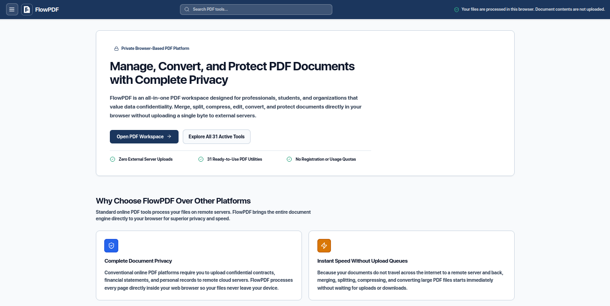
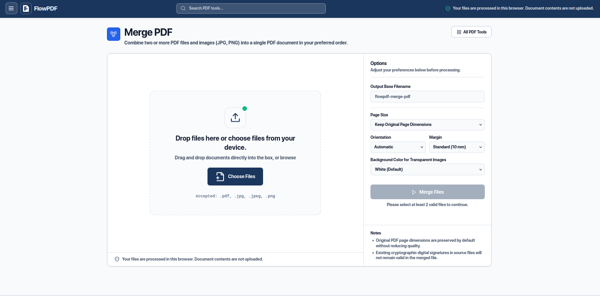
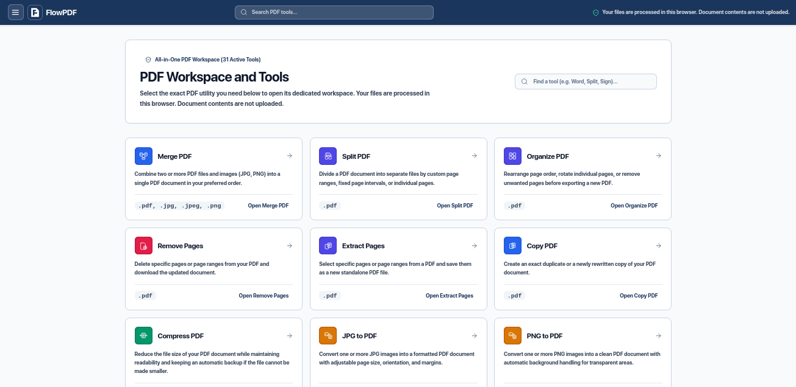
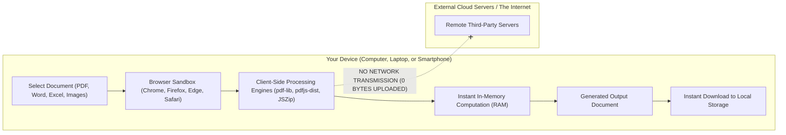

# FlowPDF

> **A fast, privacy-first PDF and document workspace that runs 100% inside your web browser. No server uploads. No data collection. Free and open source.**

[](https://flowpdf.vercel.app)
[](LICENSE)
[](#privacy-guarantee)
[](https://react.dev/)
[](https://www.typescriptlang.org/)

**Live Website:** [https://flowpdf.vercel.app](https://flowpdf.vercel.app)

---

## UI Preview







---

## Overview

FlowPDF is an all-in-one document workspace designed for anyone who needs to merge, split, compress, edit, or convert PDF and Office documents without compromising their data privacy.

Unlike conventional online document converters, FlowPDF is a 100% static, client-side web application. Every single operation, whether merging contracts, extracting pages, converting Word files to PDF, or turning spreadsheets into documents, takes place inside your own device's web browser memory. Your files never touch any external server.

---

## The Problem: The Hidden Danger of Online PDF Converters

Every day, millions of people search for quick ways to perform simple PDF tasks:
- "Merge two PDF files"
- "Convert scanned bank statement to Excel"
- "Compress PDF for job application"
- "Convert Word document to PDF"

To solve these simple tasks, most people casually upload their files to popular online PDF websites without realizing what actually happens behind the scenes:

1. **Your Confidential Files Are Transmitted Over the Internet:** When you click "Upload", your document is sent across the web to a remote third-party cloud server located thousands of miles away.
2. **Highly Sensitive Data is Exposed:** People frequently upload documents containing critical personal information:
   - National identity cards, passports, and driver's licenses
   - Bank account statements and tax returns
   - Medical records and health diagnoses
   - Employment contracts, NDAs, and corporate financial reports
   - Private documents belonging to other people (clients, family members, or students)
3. **Data Logging, Breaches, and Illegal Data Trading:** Once your file reaches an external server, you have lost control over it. Even if a website claims that files are deleted after one hour, files can be cached, logged, indexed, or stored in temporary storage. When these databases are compromised, sensitive personal records are frequently stolen and sold by malicious actors on data leak forums.

### Why FlowPDF Was Created
FlowPDF was created out of deep concern over this dangerous practice. Performing a simple mathematical task, such as reordering pages or merging two PDF files, should never require you to send private documents to someone else's server.

FlowPDF gives you all the tools you expect from commercial online PDF platforms, but with a completely safe, static architecture: the entire engine runs directly inside your web browser. The website host cannot see, read, or store your documents, because your documents never leave your computer.

---

## Why Choose FlowPDF?

You might ask: "There are many other PDF platforms on the internet. Why should I use FlowPDF?"

### 1. Privacy is a Fundamental Right, Not an Afterthought
Many platforms offer privacy as an optional, paid enterprise feature, or rely on promises such as "Trust us, our cloud servers delete files after 60 minutes."

FlowPDF is built on a single, uncompromising principle: Privacy is a fundamental right for every internet user. We do not ask you to trust our server deletion policy because we have no server. If a platform never receives your files in the first place, it is physically impossible for your files to be logged, leaked, or stolen.

### 2. Instant Speed Without Upload or Download Queues
When you use cloud-based tools, you must wait for your file to upload to the server, wait in a processing queue, and then wait for the result to download back.

FlowPDF executes instantly. Merging a 50 MB PDF happens in fractions of a second because your computer's own processor and memory perform the work locally.

### 3. No Daily Quotas, No Accounts, and No Watermarks
- **No Sign-Up or Registration Required:** Start working immediately.
- **No Task Limits:** Process as many files as you want.
- **Clean Professional Output:** We will never stamp promotional watermarks onto your documents.
- **100% Free and Open Source:** The code is completely transparent and inspectable by anyone.

---

## How It Works (Workflow and Architecture)

FlowPDF utilizes modern web standards (HTML5 Canvas, FileReader, WebAssembly, and optimized JavaScript engines) to process document binary structures entirely within the browser sandbox.

### Workflow Architecture Diagram



### Step-by-Step Execution:
1. **Selection:** You select or drag and drop your files into the workspace.
2. **In-Memory Loading:** The browser's native FileReader API reads your file bytes into local device memory (RAM).
3. **Local Processing:** Client-side libraries (pdf-lib, pdfjs-dist, jszip) manipulate the document object tree directly on your device.
4. **Instant Verification:** The document structure is validated in real time to ensure integrity and formatting correctness.
5. **Direct Download:** The browser generates a local blob URL (`blob:http...`), allowing you to save the file immediately without transferring a single byte over the network.

---

## Features and Capabilities

FlowPDF includes over 30 active document utilities in a single, unified workspace:

| Category | Available Tools |
| :--- | :--- |
| **Organize and Pages** | • **Merge PDF:** Combine multiple PDF files and images in any order.<br>• **Split PDF:** Split by custom page ranges or individual pages.<br>• **Organize PDF:** Visually rearrange, rotate, and organize pages.<br>• **Remove Pages:** Click any page visually to delete it.<br>• **Extract Pages:** Save specific pages into a new document.<br>• **Insert and Replace Pages:** Insert pages from another PDF or replace specific sheets.<br>• **Duplicate PDF:** Create exact byte copies or refreshed document structures. |
| **Office and Documents** | • **Word to PDF:** Convert `.docx` documents to standard PDF.<br>• **PDF to Word:** Extract text and paragraph structures to editable `.docx`.<br>• **Excel to PDF:** Turn `.xlsx` or `.csv` sheets into formatted tables.<br>• **PDF to Excel:** Convert PDF tables to `.xlsx` (includes automatic Scanned PDF detection with full-screen OCR alert).<br>• **PowerPoint to PDF:** Render `.pptx` slides to landscape PDF.<br>• **PDF to PowerPoint:** Convert PDF pages into editable `.pptx` presentations. |
| **Images and Web** | • **JPG to PDF** and **PNG to PDF:** Convert photos into documents.<br>• **PDF to JPG** and **PDF to PNG:** High-resolution page image exports.<br>• **HTML to PDF:** Securely render clean web pages to PDF.<br>• **Markdown to PDF:** Convert formatted `.md` notes into documents.<br>• **PDF to Text / Markdown:** Extract clean selectable text. |
| **Edit and Inspect** | • **Rotate PDF:** Rotate pages by 90, 180, or 270 degrees with live visual preview.<br>• **Add Page Numbers:** Insert customizable page numbering.<br>• **Add Watermarks:** Apply clean text stamps.<br>• **Crop PDF:** Adjust visible page margins.<br>• **Compare PDF:** Side-by-side structural and text comparison between two documents. |
| **Privacy and Security** | • **Sanitize Metadata:** Permanently erase author names, creation software, and hidden metadata dictionaries.<br>• **Scanned PDF Detection:** Full-screen alert prompting for OCR when trying to convert scanned image PDFs to spreadsheets. |
| **Automation** | • **Workflow Builder:** Chain multiple PDF actions into one automated sequence.<br>• **Batch Processing:** Apply actions across dozens of documents simultaneously with error isolation. |

---

## System Requirements

Because FlowPDF runs entirely on your device, it requires no server infrastructure:

| Component | Minimum Specification | Recommended Specification |
| :--- | :--- | :--- |
| **Operating System** | Windows 10+, macOS 11+, Linux (Ubuntu, Fedora, Arch), Android, or iOS | Any modern 64-bit OS |
| **Web Browser** | Any modern browser supporting WebAssembly and HTML5 Canvas (Chrome 90+, Firefox 90+, Edge 90+, Safari 15+) | Latest Google Chrome, Mozilla Firefox, or Microsoft Edge |
| **Memory (RAM)** | 2 GB RAM (for everyday PDF files under 20 MB) | 4 GB+ RAM (for large 100+ page documents or high-resolution image conversions) |
| **Node.js (for developers)** | Node.js v18.0.0 or higher | Node.js v20 LTS or higher |

---

## Getting Started and Installation

You can either use the live web version or run FlowPDF completely offline on your own machine.

### Method 1: Running Locally (Windows, macOS, Linux)

#### 1. Clone the Repository
```bash
git clone https://github.com/davizofficial/FlowPDF.git
cd FlowPDF
```

#### 2. Install Dependencies
```bash
npm install
```

#### 3. Run the Development Server
- **On Windows (PowerShell or Command Prompt):**
  ```powershell
  npm run dev
  ```
- **On macOS (Terminal):**
  ```bash
  npm run dev
  ```
- **On Linux (Bash):**
  ```bash
  npm run dev
  ```

Open your browser and navigate to `http://localhost:5173`. You can now use FlowPDF completely offline, even if you disconnect from the internet.

#### 4. Build for Production
To generate an optimized static build:
```bash
npm run build
```
The compiled files will be output to the `dist/` folder, ready to be hosted on any static web server (Vercel, Cloudflare Pages, GitHub Pages, Nginx, Apache).

---

### Method 2: Deploying to Vercel (1-Click Deployment)

FlowPDF is designed to deploy seamlessly to Vercel because it is a pure static single-page application.

#### Option A: Deploy via Vercel Dashboard
1. Fork or push this repository to your GitHub account (`https://github.com/davizofficial/FlowPDF`).
2. Log in to Vercel and click "Add New Project".
3. Import your FlowPDF repository.
4. Vercel will automatically detect the Vite framework:
   - Build Command: `npm run build`
   - Output Directory: `dist`
   - Install Command: `npm install`
5. Click "Deploy". Your application will be live in less than a minute.

#### Option B: Deploy via Vercel CLI
```bash
# Install Vercel CLI globally
npm i -g vercel

# Deploy directly from your project directory
vercel
```

---

## Testing and Verification

FlowPDF includes an automated test suite verifying functional accuracy, OpenXML validation, and zero-network privacy guarantees:

```bash
# Run TypeScript strict type verification
npm run typecheck

# Run ESLint static code quality analysis
npm run lint

# Run unit, integration, and zero-network privacy tests
npm test

# Build production bundle with full typecheck
npm run build
```

---

## Discussions and Contributing

Contributions from the open-source community are very welcome. Whether you want to fix a bug, suggest a new tool, improve translations, or enhance accessibility:

1. **Ask questions or share ideas:** Open a discussion in GitHub Discussions (`https://github.com/davizofficial/FlowPDF/discussions`).
2. **Report a bug or request a feature:** Submit an issue on GitHub Issues (`https://github.com/davizofficial/FlowPDF/issues`).
3. **Contribute code:**
   - Fork the repository.
   - Create your feature branch (`git checkout -b feature/amazing-feature`).
   - Commit your changes (`git commit -m 'feat: add amazing feature'`).
   - Push to your branch (`git push origin feature/amazing-feature`).
   - Open a Pull Request.

---

## Author

Created and maintained by **davizofficial**.
- GitHub: [davizofficial](https://github.com/davizofficial)
- Project Repository: [https://github.com/davizofficial/FlowPDF](https://github.com/davizofficial/FlowPDF)

---

## License

This project is licensed under the MIT License. You are free to use, modify, distribute, and self-host this application for both personal and commercial purposes. See the LICENSE file for details.
